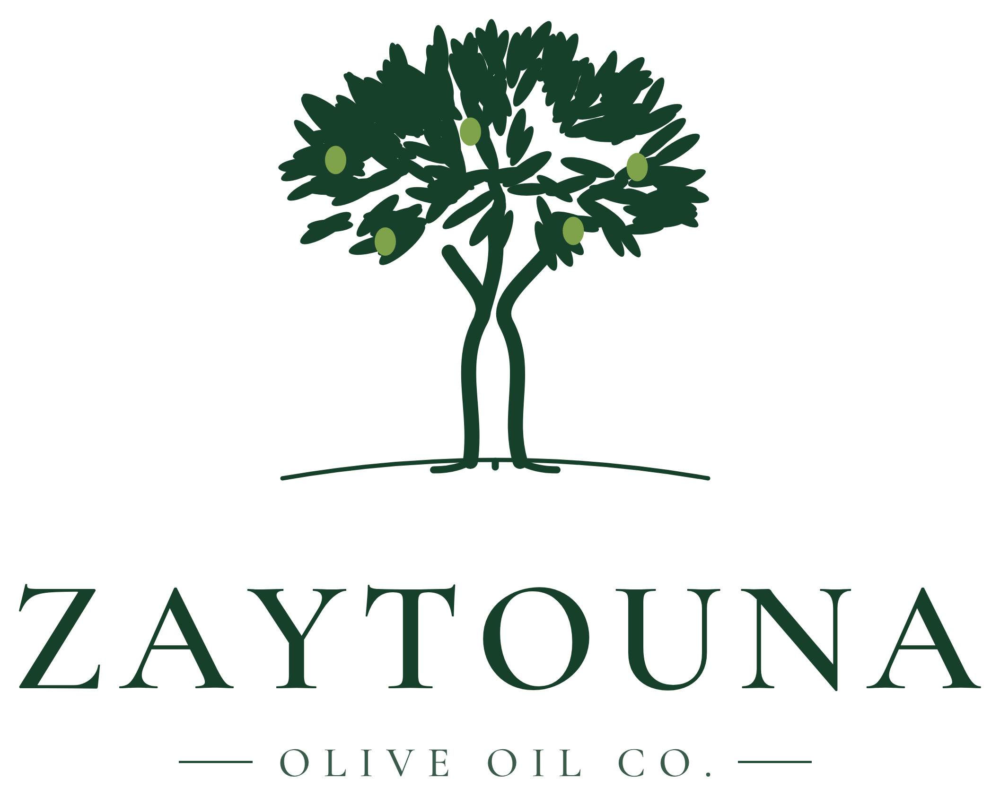

# Zaytouna — confirmed brand reference

Recorded from the user's instructions on 15 November 2026. This reference
supersedes the earlier generic food-manufacturing visual direction and the
separate Procurement Operations Room design prototype for future frontend work.

## Company and product

- Arabic name: زيتونة.
- English wordmark: ZAYTOUNA.
- Logo descriptor: OLIVE OIL CO.
- Business: olive oil production and export.
- Existing application: the team's sourcing and tender management system for
  this company. The brand change alone does not authorize changing its workflows.
- Desired frontend: exceptional, distinctive and polished, grounded in the
  confirmed palette, typography and supplied olive-tree identity.

## Work boundaries

- Current request is to save the reference only. Do not implement page styles yet.
- Home is owned by the user's teammate. Do not modify its view, controller,
  layout or appearance through shared/global styles without later authorization.
- The user's frontend work will begin with Login, then proceed page by page.
  Wait for the next page-specific instruction before implementing Login.
- Preserve existing authentication, authorization and application behavior during
  visual changes. Keep future page styles scoped so they do not affect Home.
- No new language/RTL policy, animations, layout or login features are approved
  solely by this reference.

## Exact approved palette

| Token | Hex | Intended use |
| --- | --- | --- |
| Olive 800 | #17402A | Core color: headings, dark sections, main buttons |
| Olive 900 | #10261A | Footer and darkest text |
| Olive 600 | #4E6B2F | Small labels above headings |
| Lime 400 | #DCEB4B | Accent only: the main button on dark green, and one highlighted word |
| Cream 100 | #FBF3DF | Page background |
| Cream 50 | #FFFCF3 | Cards and panels |
| Sand 200 | #F0E4C2 | Warm tints and chips |
| Sage 100 | #EEF0DC | Background behind icons |
| Ink 700 | #3A4A3E | Body text |
| Ink 500 | #5A6A5E | Secondary text |
| Success | #2F6B2A | Approved / Compliant |
| Danger | #B4411E | Rejected / Non-compliant |

## Exact approved typography

| Typeface | Role |
| --- | --- |
| Bricolage Grotesque, weight 600 | Headings |
| DM Sans | Body text and buttons |
| DM Mono | Small labels |
| Cormorant Garamond | Logo only |

Respect the user's explicit choices, including small labels above headings and
the limited lime emphasis. Do not substitute defaults from design skills.
Font installation/self-hosting, additional weights and Arabic companion fonts
have not yet been implemented or selected.

## Supplied logo

The provided olive-tree logo and wordmark are preserved without modification:

This is the user-supplied raster reference, not a recreated vector or a new logo.
Preserve the original proportions and artwork. Do not infer the source font or
exact palette from pixels over the explicit specifications above.

No production CSS, fonts, pages or application code were changed when saving
this reference.
